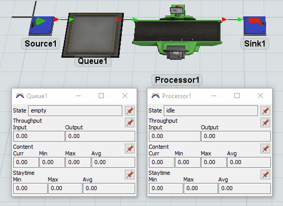

# Lab 1.1

https://help.autodesk.com/view/FLEXSIMIN/2025/ENU/?guid=FlexSim_User_Manual_gettingdata_keyconceptsdata_html

--------- 

# ELearning

## Flexsim  Basic Flexsim
  https://youtu.be/YJgJzyDHZ8o
  

- Source
  https://youtu.be/L8TOnS_oCQw
- Queue 
  https://youtu.be/D9MGhs3d01A
- Process
  https://youtu.be/7KRnZTke900
- Dispatch
  https://youtu.be/COvzdFIYqgA
- NetworkNode
  https://youtu.be/fUYSpXnn_Ic
-------------
## Task Executer
  https://youtu.be/8TW5h-ExEHU
  

## Lab Flexsim Conveyors
  https://youtu.be/QeJBqJN4WTc
  

## Lab Flexsim Decidetion Point

  https://youtu.be/_HVfnPHlzXI
  

## Lab Flexsim Transporter
  https://youtu.be/eF4FXxdbU30
  

## Lab Flexsim Map
  - Processflow (2D logic)
    https://youtu.be/F72PIiGvP8I

